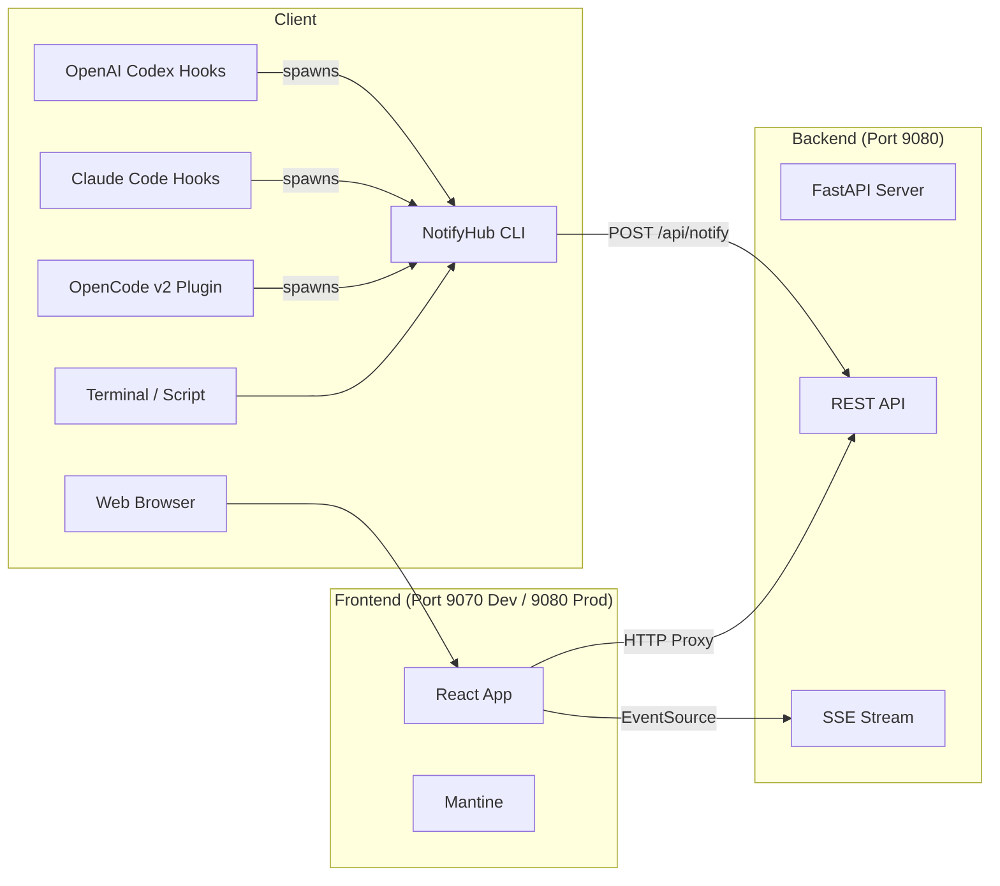
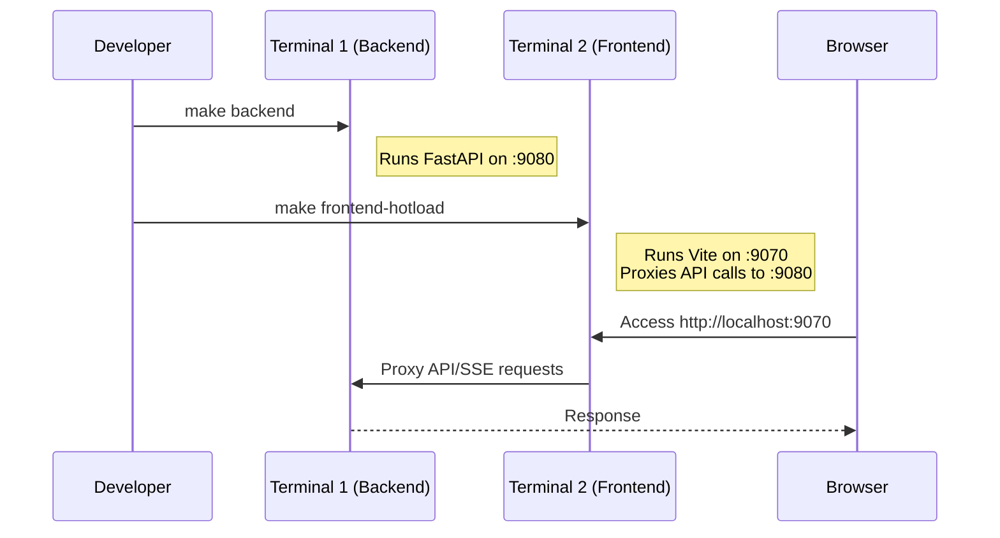
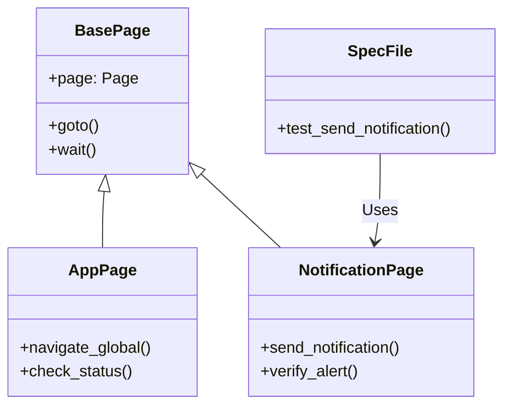

# NotifyHub

> **Summary**: NotifyHub is a single-page notification application designed for developers. It provides a real-time notification center where external processes, CLI tools, and CI/CD pipelines can push notifications. It was built primarily for integration with the **OpenCode** AI coding assistant, and also ships integrations for **Claude Code** and **OpenAI Codex**, but serves as a general-purpose notification hub.

- [NotifyHub](#notifyhub)
  - [1. What Is This Project?](#1-what-is-this-project)
  - [2. Tech Stack](#2-tech-stack)
  - [3. Directory Structure](#3-directory-structure)
  - [4. Frontend Architecture](#4-frontend-architecture)
  - [5. State Management](#5-state-management)
  - [6. Real-time Communication](#6-real-time-communication)
  - [7. Audio Handling](#7-audio-handling)
  - [8. Testing Setup](#8-testing-setup)
  - [9. Build Tooling](#9-build-tooling)
  - [10. Installation & Setup](#10-installation--setup)
  - [11. Backend Configuration](#11-backend-configuration)
  - [12. Frontend Loading Modes](#12-frontend-loading-modes)
  - [13. Production Usage](#13-production-usage)
  - [14. Testing Strategy](#14-testing-strategy)
  - [15. CLI Usage](#15-cli-usage)
  - [16. Terminal UI (TUI)](#16-terminal-ui-tui)

## 1. What Is This Project?

**NotifyHub** is a single-page notification app for developers, combining Python FastAPI backend with React frontend. Uses Server-Sent Events for real-time alerts and includes audio notifications with autoplay. Features CLI integration, Mantine UI, and Playwright testing. Supports hot-reload development and production static serving. The repo contains:

- A **web UI** (React) for viewing/managing notifications
- A **Python backend** (FastAPI) serving REST + SSE
- A **CLI** for pushing notifications from scripts/terminals
- A **TUI** (terminal UI) for viewing notifications in the terminal
- An **OpenCode v2 plugin** that turns turn completions, errors, permission prompts, and questions into notifications
- **Claude Code** and **OpenAI Codex** hook scripts that provide the same notifications for those coding agents

### Architecture Diagram



---

## 2. Tech Stack

| Layer | Technology |
|---|---|
| **Backend** | Python 3 + FastAPI + Uvicorn + Pydantic |
| **Crypto** | `cryptography` (AES-256-GCM) on the server; WebCrypto in the TUI |
| **Frontend** | React 18, TypeScript |
| **Styling** | Mantine v8 (provider + modals), custom CSS with TUI palette tokens, PostCSS + Autoprefixer |
| **Build / Package Manager** | **Bun** (package manager and runtime for `bun run dev`), **Vite 5** (bundler) |
| **Real-time** | Server-Sent Events (SSE) via `sse-starlette` |
| **Animation** | CSS shimmer + braille spinner for waiting cards |
| **Hashing** | 32-bit string hash for avatar and host/agent pill colors |
| **Backend Testing** | pytest + pytest-asyncio + HTTPX (FastAPI TestClient) |
| **Frontend Testing** | Playwright (E2E, CDP) + `bun test` (unit) |
| **Config Stack** | Custom `confstack` library for layered config (defaults -> config file -> CLI args) |
| **Containerization** | Docker (multi-stage: Node 18 Alpine for frontend build, Python 3.11 slim for backend) |
| **Language Server** | Pyright |

---

## 3. Directory Structure

```
NotifyHub/
├── README.md
├── Makefile                          # Task runner for all operations
├── pyproject.toml                    # Python packaging (setuptools)
├── requirements.txt
├── pytest.ini
├── pyrightconfig.json
├── Dockerfile                        # Multi-stage: frontend build + backend
├── docker-compose.yml
├── docs/                             # Plans, issues, code reviews
│   ├── plans/
│   ├── issues/
│   ├── refs/
│   └── _meta/                        # How-to guides (e.g., how-to-prototype.md)
├── tests/                            # pytest suites (tests/notifyhub/...)
├── local/                            # Shell scripts (e.g., push-funnel-noti.sh)
├── exp/                              # Experimental / scratch space
└── src/
    └── notifyhub/
        ├── __init__.py
        ├── config.py                 # Pydantic config models (loaded via confstackify)
        ├── crypto.py                 # AES-256-GCM envelope crypto + key resolution
        ├── telegram.py               # Telegram bot integration
        ├── backend/
        │   ├── backend.py            # FastAPI app, SSE, API routes, server entrypoint
        │   └── models.py             # Notification record + NotificationStore
        ├── cli/
        │   ├── cli.py                # CLI tool to push notifications
        │   └── __tests__/
        ├── tui/                      # Terminal UI (React + @opentui)
        │   ├── package.json
        │   ├── tsconfig.json
        │   └── src/
        │       ├── index.tsx
        │       ├── prototype.tsx        # mock-data harness entry
        │       ├── render.tsx
        │       ├── App.tsx              # AppView shell + live data wiring
        │       ├── types.ts
        │       ├── prototypes/          # harness, scenarios, temporary seams
        │       ├── components/
        │       ├── hooks/
        │       └── utils/                # api.ts, crypto.ts (e2e decrypt)
        ├── plugins/
        │   ├── opencode/             # OpenCode v2 integration plugin
        │   │   ├── notifyhub-plugin.ts
        │   │   ├── package.json
        │   │   └── tsconfig.json
        │   ├── claude/               # Claude Code hooks integration
        │   └── codex/                # OpenAI Codex hooks integration
        └── frontend/
            ├── package.json          # Bun-managed deps
            ├── tsconfig.json         # TypeScript config (tsc --noEmit)
            ├── vite.config.js        # Vite config with proxy
            ├── postcss.config.js     # PostCSS with autoprefixer
            ├── tailwind.config.js    # Vestigial (unused)
            ├── playwright.config.ts  # Playwright test config
            ├── index.html            # App entry HTML (Inter font)
            ├── prototype.html        # Prototype harness entry (mock data)
            ├── static/               # Build output (Vite outputs here as "outDir")
            ├── public/
            │   └── audio/            # Audio files (Submarine.mp3)
            └── src/
                ├── main.tsx          # React entry: MantineProvider + StrictMode
                ├── App.tsx           # Live SSE wiring -> AppView
                ├── AppView.tsx       # Presentation shell (header/feed/popups/footer)
                ├── prototype.tsx     # Prototype harness entry
                ├── theme.ts          # Mantine theme
                ├── types.ts          # NotificationItem, AgentStatusEntry, ServerInfo
                ├── index.css         # Global CSS + TUI palette tokens
                ├── notification.css  # Card/waiting-card/popup styles
                ├── prototypes/       # Harness shell, scenarios, prototype-only CSS
                ├── hooks/            # useNotifications, useNow, useAudio
                ├── components/       # cards, stream, waiting cards, popups
                └── utils/            # timestampUtils, cardUtils (+ tests)
```

---

## 4. Frontend Architecture

- **Framework**: React 18, with `createRoot` rendering into `#root`
- **UI Library**: **Mantine v8** — supplies the provider, `Modal` popups, buttons and the `ColorSchemeScript`. The feed and cards are custom CSS so the web UI can share the TUI's design language.
- **Design**: The web UI mirrors the TUI prototype: bordered notification cards, a colored project avatar, bold title, `host_model` pill, relative timestamp, dimmed pwd path, tag/truncation rendering, and live **waiting cards** for agent sessions. There is no fan-in compression; cards are dense and content-measured.
- **CSS Approach**:
  1. **Mantine's stylesheet** — `@mantine/core/styles.css` (global tokens + component styles, including the modals)
  2. **Custom CSS** — `index.css` defines the TUI palette as `--nh-*` tokens (dark + light); `notification.css` styles the shell, cards, waiting cards and popups
  3. **PostCSS** — only `autoprefixer` plugin active
- **Cards**: `NotificationCard` renders the TUI card. `[#tag:...]` markers use the accent color; adjacent `[#truncated:...]` markers collapse into `[+24 lines, +517 chars]`. A locked e2e envelope renders as a `LOCKED` card with the envelope `kid` (the web UI does not decrypt).
- **Waiting cards**: `WaitingCards` renders `running` / `blocked` / `stale` agent sessions above the feed. Running cards show a shimmering per-turn gerund plus a braille spinner; blocked cards turn amber (`waiting for you ⚠`); stalls turn red (`stalled? ◼`). Idle entries are hidden, and a completion notification with `data.session_id` resolves the matching card.
- **Pagination**: the SSE `init` event is capped at 30 items. `NotificationStream` lazy-loads older pages with `GET /api/notifications?limit=30&before=<oldest id>` when its sentinel enters view, and the footer shows the loading state.
- **Popups**: `StatusPopup` shows connection/streaming state, server address, notification count, e2e state and locked count. `HelpPopup` lists the keyboard shortcuts. Both are Mantine modals styled with the TUI tokens.
- **Prototype**: `make frontend-prototype` mounts the real `AppView` and components against fixtures in `src/prototypes/` — no backend, SSE or e2e key. Rules: [`docs/_meta/how-to-prototype.md`](docs/_meta/how-to-prototype.md).
- **Component Tree**:
  - `<MantineProvider>` wraps `<App>`
  - `<App>` owns the live data hooks (`useNotifications`, `useAudio`) and passes props to `<AppView>`
  - `<AppView>` renders the header, status/audio alerts, `<WaitingCards>`, `<NotificationStream>`, the popups and the footer
  - `<NotificationCard>` renders one card (plain or `LOCKED`)
  - `PrototypeApp` renders the same `<AppView>` with fixture data and a harness-only bar

---

## 5. State Management

There is **no external state management library** (no Redux, Zustand, MobX, etc.). State is handled purely via React hooks:

- **`useNotifications`** owns:
  - `notifications: NotificationItem[]` — the loaded page(s), newest first
  - `agentStatus: AgentStatusEntry[]` — live sessions for the waiting cards
  - `serverInfo: ServerInfo` — connection, streaming, count, host/port and e2e state
  - `hasMore` / `loadingMore` — pagination state
  - `liveEventSeq` — increments only for live SSE arrivals, so audio does not fire for the initial snapshot or an older page
  - `handleDelete`, `handleClearAll`, `loadMore` — REST mutations and lazy loading
- **`useNow`** — one ticking clock shared by the cards (10 s), so relative timestamps stay fresh without a timer per card
- **`useAudio`** — creates the `Audio` element, exposes `play()`, and tracks the browser-autoplay `blocked` state
- **`AppView`** local state — status/help popup visibility; everything else is props
- State is **derived directly from SSE events** — the backend pushes `init` (newest page), `notification` (new), `clear` (delete all), `delete` (single delete), `heartbeat`, `shutdown`, and `agent_status`; the frontend updates its local arrays accordingly. A completion notification with `data.session_id` also removes the matching waiting card.
- The web client **does not decrypt e2e envelopes**; `locked: true` items render as `LOCKED` cards and the status popup shows the server `kid` and locked count.

---

## 6. Real-time Communication

The project uses **Server-Sent Events (SSE)**, not WebSockets:

- **Backend** (`backend.py`):
  - `SSEManager` class maintains a list of `asyncio.Queue` connections
  - `connect()` adds a new queue, `disconnect()` removes on close, `broadcast()` sends to all connected clients
  - The `/events` endpoint returns an `EventSourceResponse` that yields events: `init` (current notifications, capped by the optional `?limit=` query param), `notification`, `clear`, `delete`, `heartbeat` (every N seconds, configurable), `shutdown`, and `agent_status` (live agent session states — see below)
  - Uses `asyncio.wait_for(queue.get(), timeout=1.0)` for a non-blocking loop with heartbeat counting
  - `GET /api/notifications` supports pagination via `?limit=`, `?offset=`, and `?before=<id>` (stable cursor for loading older items); `GET /api/notifications/count` returns `{"count": N}` without shipping the full payload. This keeps large histories from being loaded into memory at once.

### Live agent status (`/api/status`)

The backend also tracks **which agent session is doing what right now** (RAM-only, herdr-style):
the opencode plugin and the claude/codex hooks report `running` / `blocked` / `idle` per session
to `POST /api/status/<agent>/<state>`, and every meaningful change is broadcast as an SSE
`agent_status` event. Entries carry the directory, host, a one-line excerpt of the running task,
and turn `stale` after `backend.agent_status_stale_seconds` (default 300) without a refresh.
Completion notifications carry `data.session_id`, so clients can resolve a running row exactly
when its turn's notification lands. Both the TUI (§16) and the web UI (§4) render these as waiting
notification cards; operator guide:
[`docs/important/agent-status.md`](docs/important/agent-status.md).

- **Vite proxy** (`vite.config.js`):
  - `/events` is proxied to `http://localhost:9080` with `ws: true` (WebSocket support in proxy config, though the app uses SSE not WS)

- **Frontend** (`hooks/useNotifications.ts`):
  - Single `EventSource` connects to `/events?limit=30` on mount
  - Listens for named events: `init`, `notification`, `agent_status`, `clear`, `delete`, `heartbeat`, `shutdown`
  - `onerror` marks `streaming = false`; `onopen` marks it true and resyncs `GET /api/status` + `GET /api/e2e`
  - A 15-second poll calls `GET /api/notifications/count` (and `GET /api/e2e`), never re-downloading the full list
  - REST API calls (`fetch`) handle mutations and pagination: `DELETE /api/notifications?id=…`, `DELETE /api/notifications`, and `GET /api/notifications?limit=30&before=…` for older pages. The server broadcasts the matching SSE event after a mutation.

---

## 7. Audio Handling

- **Audio file**: `public/audio/Submarine.mp3` (referenced as `/audio/Submarine.mp3`, served by FastAPI at the `/audio` mount point)
- **Setup**: `useAudio` creates an `Audio` element programmatically, with `volume = 0.5`
- **Autoplay handling**: Browsers block autoplay by default. On each live notification:
  1. `audio.currentTime = 0` (reset to start)
  2. `audio.play()` is called
  3. If it fails (catches error), `blocked` is set to `true`
  4. When `blocked` is true, a click listener is added to the `document`, and the page title changes to "Notification Center | Muted. Please click to enable audio notifications"
  5. On first user click, audio is played, `blocked` resets, and the click listener is removed
- Audio is keyed off `liveEventSeq`, so the initial `init` snapshot and lazy-loaded older pages stay silent.

---

## 8. Testing Setup

**Backend Tests** (pytest):
- Located at `tests/notifyhub/` (`backend/`, `cli/`, `test_config.py`)
- Uses `pytest`, `pytest-asyncio`, `httpx`, and FastAPI's `TestClient`
- `backend/test_models.py`: `NotificationStore` initialization, add, order, max limit, delete by ID, opaque `data`
- `backend/test_server.py`: REST endpoints plus `TestE2EEncryption` (plaintext→envelope storage, wrong-key rejection, `/api/e2e`)
- `backend/test_template.py`: production HTML transformation injects `/static/app.js` and `/static/main.css`
- `backend/test_crypto.py`: envelope round-trip, tamper/wrong-key rejection, key resolution, `--status`
- Run with: `make test-backend` → `python -m pytest tests/notifyhub -v`

**Frontend E2E Tests** (Playwright):
- Located at `src/notifyhub/frontend/__tests__/`
- **Page Object Model** pattern: `BasePage` → `AppPage` + `NotificationPage`
- `notification.spec.ts`: Uses Playwright's `extend` to connect over Chrome DevTools Protocol (CDP) to an already-running browser instance
- Testing strategy: Backup-and-restore approach — backs up existing notifications before tests, adds 8 mock notifications, runs tests, then restores original state
- Run with: `make test-frontend` (production mode, port 9080) or `make test-frontend-hotload` (dev mode, port 9070)
- Playwright config: 30s timeout, video retention on failure, `baseURL: http://localhost:9080`

**Unit Tests**:
- `timestampUtils.test.ts` — relative time (`now`, `5m ago`, `Yesterday`, `MM/DD/YY`)
- `cardUtils.test.ts` — pwd title, truncation, tag/truncation parsing, envelope detection, stale mirror, stable gerund
- Run with: `make frontend-test-unit` (`cd src/notifyhub/frontend && bun test`)

**Web Prototype Harness**:
- `make frontend-prototype` (`make fp`) → `http://localhost:9070/prototype.html`
- Runs the real `AppView` and components against fake scenarios; no backend, SSE or e2e key
- Keys: `1`–`7` scenarios, `n`/`p` cycle, `t` freeze time, `r` restart; `s`/`h`/`l` work as in the app
- Rules: [`docs/_meta/how-to-prototype.md`](docs/_meta/how-to-prototype.md)

---

## 9. Build Tooling

- **Package Manager**: **Bun** (`bun install`, `bun run dev`, `bun run build`, `bun run prototype`, `bun test`)
- **Bundler**: **Vite 5** with `@vitejs/plugin-react`
- **Vite config highlights**:
  - Dev server on port 9070
  - Proxy: `/api` → `localhost:9080`, `/events` → `localhost:9080` (with `ws: true`)
  - Build output: `static/` directory, single entry `src/main.tsx`
  - `prototype.html` is served by the dev server at `/prototype.html` and is not part of the production build
  - Deterministic asset naming (`app.js` for entry, `[name].js` for chunks, `[name].[ext]` for assets)
- **Python**: Built with `setuptools` (editable install via `pip install -e .`), scripts registered via `project.scripts` in `pyproject.toml`
- **Task Runner**: `Makefile` with shorthand aliases (`be`, `fe`, `fehl`, `fp`, `tbe`, `tfe`, `tfehl`, `ta`) for quick development
- **Type checking**: `pyrightconfig.json` for Python, `tsconfig.json` for TypeScript; the frontend and TUI use `tsc --noEmit`, and the OpenCode plugin has `npm run typecheck` (strict)
- **Linting**: `ruff` for Python (with `.ruff_cache/`), `.ripgreprc` for search config

### Key Architectural Patterns

1. **Layered config**: `confstackify()` merges defaults → JSON config file → env vars → programmatic overrides
2. **SSE-only real-time**: No WebSockets; the app uses `asyncio.Queue` per client for server-side SSE multiplexing
3. **TUI-mirrored web UI**: Notification cards, waiting cards, relative timestamps, host/agent pills, tag/truncation rendering and the dark palette all follow the TUI prototype; the web UI adds a mouse-friendly delete affordance and lazy pagination
4. **Dual-serving modes**: Hot-reload (Vite on 9070 + FastAPI on 9080 with proxy) vs. production (FastAPI serves built static files from `static/` on port 9080)
5. **CDP-based testing**: Playwright tests connect to an already-open Chrome instance rather than launching a new browser, for testing against a manually-observed session
6. **Coding-agent integrations**: `plugins/opencode/` subscribes to OpenCode v2 events directly, while `plugins/claude/` and `plugins/codex/` are hook scripts spawned per lifecycle event (see `docs/important/opencode-plugin.md`, `claude-code-hooks.md`, `codex-hooks.md`)
7. **Terminal UI**: A separate React-based TUI (`src/notifyhub/tui/`) using `@opentui` for terminal rendering
8. **Prototype harnesses**: Both clients run their real view shell against fixture scenarios — `make tui-prototype` for the terminal, `make frontend-prototype` for the browser

---

## 10. Installation & Setup

### Prerequisites

- Python 3.x
- Bun (JavaScript runtime/package manager)
- VSCode Extensions:
  - [CSS Navigation](https://marketplace.visualstudio.com/items?itemName=pucelle.vscode-css-navigation) - Enables Ctrl+click navigation for CSS imports and variable definitions

### Initial Install

Run the following to set up both backend and frontend dependencies:

```bash
# Install backend dependencies (editable mode)
pip install -e .

# Install frontend dependencies (includes testing tools)
make frontend-deps

# (Optional) Build web assets immediately
make frontend
```

### E2E Encryption (Optional)

To encrypt payloads at rest / in transit (server decrypts for push, stores and
serves only ciphertext; the TUI decrypts locally):

```bash
make e2e-status    # show the resolved key source + kid (never prints the key)
make e2e-key       # fallback: generate a standalone ~/.config/notifyhub/e2e.key
```

Then add the key next to your other settings in `~/.config/notifyhub/config.jsonl`:

```jsonc
"e2e": { "enabled": true, "key": "YOUR_KEY" }
```

Both the server and the TUI read it from there (`NOTIFYHUB_E2E_KEY` env
overrides). See [Backend Configuration](#11-backend-configuration) for details.

### Coding-agent integration maintenance

`make install-plugin` refreshes OpenCode, the shared push CLI, Claude, and Codex together.
Restart Claude and long-lived OpenCode processes; review changed Codex definitions via `/hooks`.
See [installation and rollout](docs/important/plugin-installation.md),
[machine label precedence](docs/important/notification-machine-labels.md), and
[isolated regression checks](docs/important/plugin-integration-testing.md).

The [2026-11-12 session record](docs/plans/2026/11/12/2026-11-12-plugin-labels-installation-and-permissions.md) links the parent and all affected submodules,
including hook-definition distributions, CLI contract, and tests. It records the hostname/label
mismatch, aggregate installation change, OpenCode autoaccept race, actual verification, and limits.

### OpenCode Plugin Installation (Optional)

The repo ships a plugin for **OpenCode v2.0.18+** that pushes turn completions, errors, permission prompts,
and questions to NotifyHub. See [`docs/important/opencode-plugin.md`](docs/important/opencode-plugin.md)
for the full guide.

| OpenCode v2 event | Notification |
|---|---|
| `session.execution.succeeded` / `session.execution.interrupted` | `[#tag:@USER] …` + `[#tag:@ASSISTANT] …` message excerpts |
| `session.execution.failed` | `[#opencode.error] <error message>` |
| `permission.asked` | `[#opencode.permission] OpenCode needs your permission` |
| `form.created` (the `question` tool) | `[#opencode.question] OpenCode is asking you a question` |

```bash
make install-plugin   # installs OpenCode + shared push CLI + Claude and Codex hooks
make backend          # start the NotifyHub server
opencode plugin list  # verify: id "notifyhub", state "active"
make remove-plugin    # uninstall
```

`make install-plugin` installs all three integrations. For individual updates, use
`make install-plugin-copy` (OpenCode and the shared CLI), `make install-plugin-claude`, or
`make install-plugin-codex`. Restart Claude sessions and trust Codex hooks via `/hooks` after
installation.

Permission alerts wait one second for autoaccept replies and check the request is still pending
before notifying. OpenCode status cards use the same `HOST_MODEL` → `HOSTNAME` → OS hostname
label as completed notifications.

The plugin is a **dependency-free single file** (type-only import of `@opencode/plugin`, so no
`node_modules` is needed in `~/.config/opencode`), hot-reloads when the installed file changes, and reads
`NOTIFYHUB_CLI_HOST`, `NOTIFYHUB_CLI_PORT`, `NOTIFYHUB_CLI_SCHEME`, `NOTIFYHUB_CLI_ENABLED`, and `NOTIFYHUB_PUSH_SCRIPT`. It also
mutes specific agents via `plugins.opencode.muted_agents` in the NotifyHub config (or the comma-separated
`NOTIFYHUB_PLUGINS_OPENCODE_MUTED_AGENTS`). Development happens in `src/notifyhub/plugins/opencode/`:

```bash
make plugin-deps      # npm install (types for the v2 plugin API)
cd src/notifyhub/plugins/opencode && npm run typecheck
```

### Claude Code Hooks (Optional)

The same notifications are available for **Claude Code** via its hooks system — see
[`docs/important/claude-code-hooks.md`](docs/important/claude-code-hooks.md) for the full guide.
Claude Code has no in-process plugin event stream, so the port is a Python hook script it spawns
per event, plus a merge-preserving settings installer and a plugin-layout alternative:

| Claude Code hook | Notification |
|---|---|
| `Stop` | `[#tag:@USER] …` + `[#tag:@ASSISTANT] …` message excerpts |
| `StopFailure` | `[#claude-code.error] <error message>` |
| `Notification` (`permission_prompt`) | `[#claude-code.permission] <message>` |
| `Notification` (elicitation / `agent_needs_input`) | `[#claude-code.question] <message>` |

```bash
make install-plugin         # installs OpenCode, Claude, and Codex integrations together
make backend                # start the NotifyHub server
# restart Claude Code sessions, then verify with /hooks
make remove-plugin-claude   # uninstall
```

Claude live-status and completion cards use the same machine label: `HOST_MODEL` (ignoring empty
or `Unknown`), then exported `HOSTNAME`, then the OS hostname. Re-run `make install-plugin-claude`
and restart Claude sessions after upgrading the inline status hooks.

Hooks run straight from `src/notifyhub/plugins/claude/notifyhub-claude.py` (live edits, no
reinstall), share `notifyhub-push.py` and the mute env vars with the OpenCode plugin, and the
directory doubles as a Claude Code plugin (`claude --plugin-dir src/notifyhub/plugins/claude`).
Port history: [`docs/plans/2026/10/23/2026-10-23-claude-code-hooks-port.md`](docs/plans/2026/10/23/2026-10-23-claude-code-hooks-port.md).

### OpenAI Codex Hooks (Optional)

Codex live-status cards use the same `HOST_MODEL` → `HOSTNAME` → OS hostname precedence as
completion cards. Re-run `make install-plugin-codex` and re-trust changed entries via `/hooks`
after upgrading.

The same notifications are available for **OpenAI Codex** (hooks are enabled by default) — see
[`docs/important/codex-hooks.md`](docs/important/codex-hooks.md) for the full guide. Codex also
spawns hook scripts per event, but requires non-managed hooks to be trusted once through `/hooks`:

| Codex hook | Notification |
|---|---|
| `Stop` | `[#tag:@USER] …` + `[#tag:@ASSISTANT] …` message excerpts |
| `Interrupt` | same body, recovered from the transcript |
| `PostModelRequest` (`status: failed`) | `[#codex.error] <error message>` |
| `PermissionRequest` (human reviewer) | `[#codex.permission] <reason or tool name>` |
| `PreToolUse` (`request_user_input`) | `[#codex.question] <question>` |

```bash
make install-plugin         # installs OpenCode, Claude, and Codex integrations together
make backend                # start the NotifyHub server
# open /hooks in a Codex session and trust the NotifyHub entries
make remove-plugin-codex    # uninstall
```

The installer respects `CODEX_HOME`, preserves foreign hooks, and warns when `config.toml` also has
inline `[hooks]` tables. Completion/error hooks run synchronously because `codex exec` cancels
unfinished background hooks when it exits; permission and question hooks stay async so they never
delay a prompt. Permission notifications are skipped when Codex auto-reviews the request
(`approvals_reviewer = "auto_review"`) or runs in Full Access, so only prompts that actually wait for
you notify. The directory doubles as a Codex plugin (`.codex-plugin/plugin.json` +
`hooks/hooks.json`) for marketplace / desktop distribution.
Port history: [`docs/plans/2026/11/09/2026-11-09-codex-hooks-port.md`](docs/plans/2026/11/09/2026-11-09-codex-hooks-port.md).

---

## 11. Backend Configuration

NotifyHub backend supports configuration via command-line arguments and a JSON config file for flexible deployment options.

### Command-Line Options

The backend accepts the following CLI arguments:

```bash
python -m notifyhub.backend.backend [options]
```

| Option                      | Default   | Description                                                   |
| --------------------------- | --------- | ------------------------------------------------------------- |
| `--backend.port`                    | 9080      | Port to run the server on                                     |
| `--backend.host`                    | "0.0.0.0" | Host to bind the server to                                    |
| `--backend.sse-heartbeat-interval`  | 30        | SSE heartbeat interval in seconds                             |
| `--backend.notifications-max-count` | 1000      | Maximum number of notifications to store (None for unlimited) |

**Examples:**

```bash
# Run with custom port and host
python -m notifyhub.backend.backend --backend.port 8080 --backend.host 127.0.0.1

# Limit notifications to 100 and faster heartbeat
python -m notifyhub.backend.backend --backend.notifications-max-count 100 --backend.sse-heartbeat-interval 15
```

### Configuration File

For persistent configuration, create a JSON file at `~/.config/notifyhub/config.json` (or `config.jsonl` for JSON5 with `//` comments, which is what the host uses):

```json
{
  "backend": {
    "port": 9080,
    "host": "0.0.0.0",
    "sse_heartbeat_interval": 30,
    "agent_status_stale_seconds": 300
  }
}
```

`agent_status_stale_seconds` marks a `running` agent-status entry `stale` (crashed
agent, no idle event) after that many seconds without a refresh — see
[live agent status](#live-agent-status-apistatus). Env equivalent:
`NOTIFYHUB_BACKEND_AGENT_STATUS_STALE_SECONDS`.

**Configuration Hierarchy:**
1. Hardcoded defaults
2. Config file values (if file exists)
3. CLI arguments (highest priority)

**Example config location:**
- macOS/Linux: `~/.config/notifyhub/config.json` (or `config.jsonl`)
- Copy from: `src/notifyhub/example_config.json`

---

`pip install -e .` copies the package; the Docker image installs the same way, so `docker compose build be` picks up the `cryptography` dependency automatically.

### End-to-end payload encryption (backend + TUI)

When enabled, notification payloads are stored and served as **AES-256-GCM
envelopes** — the server decrypts only at ingest (so tag matching and
Telegram/Bark/macOS push keep working), then stores/broadcasts ciphertext
only. Consumers (the TUI) decrypt locally with the same pre-shared key.

```json
{
  "backend": { ... },
  "e2e": { "enabled": true, "key": "" }
}
```

- **Key** (base64 or 64-char hex, 256-bit). For a consolidated setup keep it in
  `config.jsonl` under `e2e.key`; it is resolved in order:
  1. `e2e.key` config value (config file / `NOTIFYHUB_E2E_KEY` env) — **server**
  2. `NOTIFYHUB_E2E_KEY` env → `config.jsonl` `e2e.key` — **TUI**
  3. key file: `NOTIFYHUB_E2E_KEY_FILE` or `~/.config/notifyhub/e2e.key`
  4. keychain (macOS `security` / `secret-tool`, service `notifyhub_e2e_key`) — server only
- Generate one: `python -m notifyhub.crypto --gen-key`, or
  `python -m notifyhub.crypto --gen-key --write-default` to write a standalone
  `~/.config/notifyhub/e2e.key`. Check the resolved source with `make e2e-status`
  (prints the `kid`, never the key). ⚠️ an **empty** `NOTIFYHUB_E2E_KEY` still
  overrides the config — only set it non-empty to override.
- The TUI reads the same sources (env → `config.jsonl` → key file), so a key in
  `config.jsonl` lets `make tui` decrypt with no env var. In Docker,
  `~/.config/notifyhub` and `~/git` (read-only) are mounted, so the
  `config.jsonl` symlink resolves inside the container.
- Inbound accepts both plaintext (server encrypts it) and pre-encrypted
  envelopes (`{"e2e":1,"alg":"A256GCM","kid",…,"iv",…,"ct",…}`).
- `GET /api/e2e` reports `{"enabled", "alg", "kid"}` for clients.
- **TUI**: reads the key from `config.jsonl` (or `NOTIFYHUB_E2E_KEY` / a key
  file); undecryptable items render as a `LOCKED` row showing the envelope `kid`,
  and the status popup (`s`) shows server e2e state, local key state, and locked count.
- If `e2e.enabled` is true but no key resolves, the server logs a warning
  and falls back to plaintext (fails safe for availability).
- Note: the **web frontend does not decrypt** (out of scope) — with e2e on,
  use the TUI to read notifications.

## 12. Frontend Loading Modes

For hot-reloading, run the backend and frontend in separate terminals.

### Hot-reload Diagram



### Why the Proxy is Needed

In hot-reload mode, frontend runs on port 9070 and backend on port 9080. Since browsers block requests between different ports (CORS), the Vite dev server acts as a proxy—intercepting API calls from the browser, forwarding them to the backend on port 9080, and returning the response. The browser only sees port 9070, avoiding CORS issues.

**Setup:**

| Mode       | Frontend | Backend | Proxy Needed?        |
| ---------- | -------- | ------- | -------------------- |
| Hot-reload | `:9070`  | `:9080` | Yes                  |
| Static     | `:9080`  | `:9080` | No (served together) |

**Hot-reload flow:**

```
Browser → Frontend (:9070) → Proxy → Backend (:9080)
```

**Benefits:**

- No CORS configuration needed on backend
- Frontend hot-reloading enabled
- Clean separation of concerns

### Commands

**Terminal 1: Start Backend**

```bash
make backend
# Serves on http://localhost:9080
```

**Terminal 2: Start Frontend (Hot-Reload)**

```bash
make frontend-hotload
# Serves on http://localhost:9070 (Proxies to backend)
```

> **Note:** Access the UI at **`http://localhost:9070`** for hot-reloading.

---

## 13. Production Usage

To run the application as it would appear in production (serving built static assets via FastAPI):

1. **Build Assets:**

```bash
make frontend
# Builds React app to src/notifyhub/frontend/static/
```

2. **Start Server:**

```bash
make backend
# FastAPI serves static files from static/ at:
# - /static/* (general assets like JS/CSS)
# - /icons/* (icon files)
# - /audio/* (audio files)
# Note: When adding new asset folders to static/, update backend.py mounts accordingly.
```

3. **Access:**
   Open **`http://localhost:9080`**. (Default: Dark Theme).
4. **Send Test Notification (CLI):**

```bash
make noti
```

---

## 14. Testing Strategy

NotifyHub uses a combination of `pytest` for the backend and `Playwright` for frontend UI testing.

### Test Architecture (Page Object Model)



### 14.1 UI Test Setup

Before running UI tests, ensure Playwright browsers are installed:

```bash
# Install dependencies
cd src/notifyhub/frontend && bun install

# Install Playwright browsers
npx playwright install
```

### 14.2 Running Tests

You can run tests via standard NPM commands or the provided Makefile shortcuts.

| Scope            | Command                      | Description                                     |
| ---------------- | ---------------------------- | ----------------------------------------------- |
| **Backend**      | `make test-backend`          | Run pytest (backend only)                       |
| **UI (Prod)**    | `make test-frontend`         | Run Playwright tests against port 9080 (headed) |
| **UI (Hotload)** | `make test-frontend-hotload` | Run Playwright tests against port 9070 (headed) |
| **Connection**   | `make test-chrome`           | Test Chrome CDP connection utility              |
| **All**          | `make test-all`              | Run entire test suite                           |

### 14.3 Test Organization

The project follows the Page Object Model (POM) design pattern:

```text
src/notifyhub/frontend/__tests__/
├── pages/                  # Page Object Model classes
│   ├── AppPage.ts          # App-wide interactions
│   ├── BasePage.ts         # Base class with common methods
│   └── NotificationPage.ts # Notification-specific actions
├── specs/                  # Test specifications
│   └── notification.spec.ts
├── utils/                  # Helper utilities
│   └── test_chrome_connection.ts
└── tsconfig.json           # TypeScript configuration

tests/notifyhub/backend/
├── test_models.py          # Model tests
├── test_server.py         # Server/API tests (+ TestE2EEncryption)
└── test_crypto.py         # Envelope crypto + key resolution

tests/notifyhub/cli/
└── test_cli.py             # CLI tests
```

#### Notification Test Strategy

The `notification.spec.ts` test suite implements a backup-and-restore approach for testing. See the detailed documentation in the test file itself (`src/notifyhub/frontend/__tests__/specs/notification.spec.ts`) for the complete strategy.

### 14.4 Chrome Remote Debugging (CDP)

Tests can connect to an existing Chrome instance via the Chrome DevTools Protocol (CDP). This requires launching Chrome with specific flags.

**macOS:**

```bash
/Applications/Google\ Chrome.app/Contents/MacOS/Google\ Chrome --remote-debugging-port=9222 --remote-debugging-address=0.0.0.0 --user-data-dir=/tmp/chrome-debug
```

**Linux:**

```bash
google-chrome --remote-debugging-port=9222 --remote-debugging-address=0.0.0.0 --user-data-dir=/tmp/chrome-debug
```

---

## 15. CLI Usage

NotifyHub provides a CLI for sending notifications:

```bash
python src/notifyhub/cli/cli.py --backend.port 9080 '{"message": "Hello World"}'
```

By default the CLI talks to `http://0.0.0.0:9080`. To push to a server published
over TLS (for example a Tailscale funnel at `https://nuc.tail0ec64c.ts.net`), set
the scheme to `https` — the funnel's default `443` port is then omitted:

```bash
# Flags…
python src/notifyhub/cli/cli.py --scheme https --host nuc.tail0ec64c.ts.net --port 443 'hello'

# …or env vars (also honored by the OpenCode plugin):
NOTIFYHUB_CLI_SCHEME=https \
NOTIFYHUB_CLI_HOST=nuc.tail0ec64c.ts.net \
NOTIFYHUB_CLI_PORT=443 \
python src/notifyhub/cli/cli.py 'hello'
```

`NOTIFYHUB_CLI_SCHEME` accepts `http`/`https` (case-insensitive; `https://` is
normalized); an empty value falls back to `http`.

For people **outside your tailnet** who just need to push (no Python, no repo),
ship `local/push-funnel-noti.sh` — a dependency-free `bash`+`curl` one-file drop:

```bash
./push-funnel-noti.sh "build finished"          # or pipe: echo hi | ./push-funnel-noti.sh
NOTIFYHUB_URL=https://other.example.com ./push-funnel-noti.sh "hello"
```

> ⚠️ A funnel makes the backend **public**. It has no auth, so anyone with the URL
> can push, read, and delete. e2e encryption is not auth. See
> [`docs/important/funnel-remote-push.md`](docs/important/funnel-remote-push.md)
> for setup, client config, and the troubleshooting table.

---

## 16. Terminal UI (TUI)

A terminal front-end built with React + `@opentui` lives in `src/notifyhub/tui/`.
The web UI (§4) mirrors the same card and waiting-card design; the TUI remains the reference
implementation.

```bash
make tui           # run against the backend
make tui-prototype # run with mock data (no backend; auto-restarts on save)
make tui-test      # bun test
make tui-typecheck
make frontend-prototype # web UI with mock data (no backend)
```

Module guide: [`src/notifyhub/tui/README.md`](src/notifyhub/tui/README.md). Rendering invariants
(why cards/popups are sized the way they are): [`docs/important/tui-rendering-rules.md`](docs/important/tui-rendering-rules.md).
Prototype rules: [`docs/_meta/how-to-prototype.md`](docs/_meta/how-to-prototype.md).
Design history:
[`2026-11-11-tui-prototype-polish.md`](docs/plans/2026/11/11/2026-11-11-tui-prototype-polish.md),
[`2026-11-11-tui-prototype-mode.md`](docs/plans/2026/11/11/2026-11-11-tui-prototype-mode.md)
and
[`2026-11-11-tui-waiting-card-machine-id.md`](docs/plans/2026/11/11/2026-11-11-tui-waiting-card-machine-id.md).

`make tui-prototype` runs the real `AppView` and cards against fake scenarios — waiting states,
card variants, locked rows, empty/offline, pagination — with no SSE or e2e key. It runs under
`bun --watch`, so saving a source file restarts the harness automatically (prototype state resets
on restart; Bun's `--hot` cannot preserve a React/OpenTUI root across reloads). Use `1`–`7` or
`n`/`p` to switch scenarios, `t` to freeze relative time, and `r` to restart the harness (scenario
1, live clock, no deletions/popups).

### Keys

| Key | Action |
| --- | --- |
| `v` | Toggle select mode |
| `j`/`k` or `↑`/`↓` | Move selection (select mode); `PgUp`/`PgDn` by five, `Home`/`End` to the ends |
| `Delete`/`Backspace` | Delete selected card (select mode) |
| `Esc` | Deselect |
| `↑`/`↓`/`←`/`→` | Scroll the feed (select mode off) |
| `l` | Load older notifications |
| `s` | Status popup (`h`/`?` for help) |
| `q` | Quit (exit code 0) |

Cards measure their content, so there is no blank padding after a resize. Normal feed cards use a
soft gray border; the selected card uses the accent. Popups are sized to their content: Help is
18 rows, Status 17 rows and wide enough for a funnel `host:port`.
With e2e encryption enabled, the TUI prints the key source on startup
(`make tui` → `e2e key: config e2e.key (kid …)`) and decrypts automatically using
the key from `~/.config/notifyhub/config.jsonl` (or `NOTIFYHUB_E2E_KEY` / a key
file). Rows it cannot decrypt render as `LOCKED`.

### Live agent waiting cards

Above the stream, **sessions in motion** render as notification cards in waiting: the
project header, coding-agent pill (`◇ opencode`, `✳ claude`, `◐ codex`) and the reporting
machine's host pill (`⌂ Mac153`), the running prompt on the `@USER` line, and `@ASSISTANT` with
a shimmering per-turn loading gerund + `⠙` snapped to the card's bottom-right while running.
Permission/input waits turn the border and line amber (`waiting for you ⚠`); a session silent for
5 minutes turns them red (`stalled? ◼`). Docked cards stack border-to-border with a faint
state-colored background wash. Cards vanish when the turn finishes — resolved by `session_id`
against the completion notification — and resync from `GET /api/status` on reconnect. Details:
[`docs/important/the-tui.md`](docs/important/the-tui.md) and
[`docs/important/agent-status.md`](docs/important/agent-status.md). Design, trials and lessons:
[`2026-11-11-tui-prototype-polish.md`](docs/plans/2026/11/11/2026-11-11-tui-prototype-polish.md)
and
[`2026-11-11-tui-waiting-cards.md`](docs/plans/2026/11/11/2026-11-11-tui-waiting-cards.md).

### Paginated loading

The TUI does **not** keep every notification in memory. On startup it opens the SSE
stream with `?limit=<page size>`, so the `init` event carries only the newest page.
Scrolling to the bottom (or pressing `l`) lazy-loads older pages via
`GET /api/notifications?limit=&before=<oldest loaded id>`. The `before` cursor is
stable even as new notifications arrive, and a short page signals the end of history.
The 15-second status poll only calls `GET /api/notifications/count`, so it never
re-downloads the full list.

| Env var | Default | Description |
| ------- | ------- | ----------- |
| `NOTIFYHUB_CLI_HOST` | `localhost` | Backend host |
| `NOTIFYHUB_CLI_PORT` | `9080` | Backend port |
| `NOTIFYHUB_CLI_SCHEME` | `http` | URL scheme (`http`/`https`). Set `https` to reach a TLS endpoint such as a Tailscale funnel; the `443` default port is then omitted from the address |
| `NOTIFYHUB_CLI_ENABLED` | `true` | Parsed via `booleanify` (`1/on/t/true/y/yes` ↔ `0/off/f/false/n/no`); `false` mutes sends. Exporting `NOTIFYHUB_CLI_HOST` or `NOTIFYHUB_CLI_PORT` as an empty string also mutes — the CLI and plugin exit silently |
| `NOTIFYHUB_SESSION_ID` | _(unset)_ | When set (by the NotifyHub agent plugins/hook scripts), the pushed notification carries `data.session_id` so it correlates with its live status entry |
| `NOTIFYHUB_TUI_PAGE_SIZE` | `30` | Notifications loaded per page (`init` + each lazy load) |
| `NOTIFYHUB_E2E_KEY` | _(unset)_ | AES-256-GCM key (base64/hex) to decrypt e2e envelopes; overrides config/key file |
| `NOTIFYHUB_CONFIG` | `~/.config/notifyhub/config.jsonl` | Config file to read `e2e.key` from (JSON5) |
| `NOTIFYHUB_E2E_KEY_FILE` | `~/.config/notifyhub/e2e.key` | Key-file fallback when env/config are unset |
