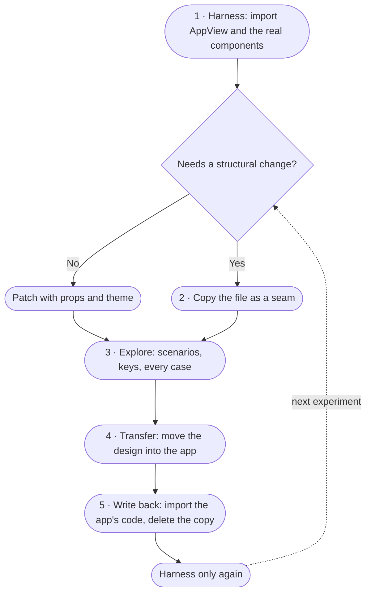

# How to prototype: copy-on-write against the real TUI

How to try a TUI change on mock data without forking the app. `make tui-prototype` is the worked
example: it runs the real `AppView` and components against scenario fixtures in the terminal.

> Adapted from `hanoi-testing-platform/docs/_meta/how-to-prototype.md`, which applies the same
> copy-on-write loop to a web app. This version replaces pages and CSS with terminal scenarios,
> keys and Yoga layout.

## The idea

A prototype is the real app's code running in a harness, not a mock-up drawn beside it. It
**imports** the app's components, theme and helpers. It **copies** a file only when the experiment
has to change that file's structure. When the design lands in the app, the prototype **points
back** at the app's code and deletes its copy.

### Why

- **Copies drift.** A `WaitingCard` copied into the prototype keeps getting edits, and so does the
  original. Within days, neither is "the" version. A prototype still running its copy after the
  transfer shows a design that no longer exists in the app.
- **A prototype on real code tests the real thing.** Yoga measurement, wrapping, theme tokens,
  selection, popup sizing and overflow all come from the app. Whatever looks right in the
  prototype looks right in the app.
- **The prototype stays useful after the transfer.** Written back, it becomes a fixture screen:
  every case on one command, driven by fake data, on today's code.

## The parts of a TUI prototype

| Part | What it is | Lives in the prototype? |
|---|---|---|
| Harness entry | `src/prototype.tsx` + `renderTui()` boot | Yes, always |
| Harness shell | `prototypes/PrototypeApp.tsx` — scenario switcher, frozen clock, prototype bar | Yes, always |
| Scenarios | `prototypes/scenarios.ts` — fake data for every case | Yes, always |
| Fake data boundary | `AppViewProps`: notifications, agent statuses, server info, handlers | Yes, always |
| Patch layer | `AppView` props, `theme.tsx` tokens, component props | Small, permanent |
| Seam | A copy of an app file whose structure the experiment changes | Only during the experiment |
| Everything else | `AppView`, `WaitingCards`, `NotificationStream`, `NotificationRow`, popups, theme | No: imported |

## 1. Build the harness on the real code

- **Import, don't copy.** `PrototypeApp` renders the real `AppView`. The cards, popups, footer and
  keyboard routing are the app's. Only the data and the prototype bar are fake.
- **Fake the data at the boundary, not inside a component.** `AppView` already takes plain
  `NotificationItem[]`, `AgentStatusEntry[]` and `ServerInfo`; the prototype passes fixtures. No
  `fetch`, SSE, e2e key or backend is involved.
- **Cover every case, one scenario each.** `1`–`7` jump to a scenario; `n`/`p` cycle. The bar
  names the current scenario so a screenshot is self-describing.
- **The terminal is the viewport.** Resize it to try narrow and short layouts. A 40-column run is
  the narrow check; a short window shows whether waiting cards squeeze the feed.
- **Make time controllable.** `t` freezes/unfreezes relative timestamps and the 5-minute stale
  mirror at the current moment. Scenario timestamps are built against a reference time, so
  "2m ago" does not drift between renders. The spinner and loading-word shimmer still animate —
  they are state, not time. The gerund itself is seeded per turn, not rotated on a timer.
- **Keep the page chrome apart.** `PrototypeBar` is harness-only. Do not move it into `AppView` or
  `App`; the app should never show "PROTOTYPE".

## 2. Change the look with props and theme before you copy

Most experiments are a look, not a structure. Try them in this order:

1. **Theme tokens.** `theme.tsx` holds `accent`, `border`, `pwdText`, `warning`, etc. Set a value
   in `DARK_THEME`/`LIGHT_THEME` or add a token and pass it through.
2. **Props the component already has.** `AppView` accepts `header`, `footerExtra`, `now`,
   `hasMore`, `loadingMore`, `lockedCount`; `WaitingCards` takes `entries` and `now`; cards take
   `selected` and `now`.
3. **Add a hook prop.** If a prototype knob must exist but the app should keep its current choice,
   add an optional prop whose default is the app's behaviour. `AppView`'s `now`, `header` and
   `footerExtra` were added exactly this way: the app passes nothing.

## 3. Copy a file as a seam only for structure

If the experiment changes markup, state or logic that no prop or theme token can reach, copy that
one file into `prototypes/seams/`:

- Copy **only the file that changes**; point its imports back at the app (`../../components/...`,
  `../../theme`).
- Mark every change in the copy (`// prototype: …`) so the diff against the original is readable.
- Put a header at the top naming the app file it copies and stating that it is a seam.
- Wire the seam into `PrototypeApp`. If the seam replaces part of `AppView`, either pass it through
  a hook prop or copy `AppView.tsx` itself as the seam — one file, not the whole tree.
- Remember to remove the seam when the design is transferred.

## 4. Explore

- **Each open question is a key or a scenario.** Add scenarios to `buildScenarios()` rather than
  stacking every case on one screen. Use `n`/`p` or the number keys to compare.
- **Keep fixtures honest.** Use real-looking paths, hostnames, agent names, task lengths and counts,
  including the long, the empty and the missing.
- **Use the real keys.** `v` enters select mode; `s`/`h` open the real popups; `l` shows the
  pagination loading state. The prototype is for those interactions too, not just static looks.
- **Measure, don't eyeball.** `testRender(<PrototypeApp />, { width, height })` +
  `captureCharFrame()` assert rows; `captureSpans()` asserts colors. Try 40/80/120 columns. For
  the real terminal, run in tmux, drive keys, and capture the pane.

## 5. Transfer into the app

- Move the seam's changes into the app file, fixing the prototype's chosen options as the app's
  defaults.
- Move harness-only rules out of the way. If a style belongs to the app, put it in `theme.tsx` or
  the component; leave the prototype bar behind.
- Wire real data in place of the fixture: the SSE store (`useNotifications`) provides exactly the
  fields the prototype faked.
- Test the app: `make tui-test`, `make tui-typecheck`, and a real run against the backend.

## 6. Write back: point the prototype at the app

The transfer is not done until the prototype stops using its copy.

1. Change `PrototypeApp`'s imports from the seam to the app's file.
2. Delete the seam and any helper copies the app now has.
3. Reduce the patch layer to knobs only. Drop props or scenario data that only restated the app's
   defaults.
4. Remove comparison controls that compared the old look with the new one.
5. Run `make tui-prototype` again: each remaining key and scenario should still show the thing it
   names.
6. Update `docs/_meta/how-to-prototype.md`, `src/notifyhub/tui/src/prototypes/README.md`, and the
   plan log.

Afterwards, a diff of `src/notifyhub/tui/src/prototypes/` should show mostly deletions.

## Checklist

- [ ] The prototype renders the app's `AppView` and components.
- [ ] Fake data enters through `AppViewProps`; no backend, SSE or e2e key is needed.
- [ ] Every case has a scenario; `n`/`p` and the number keys reach it.
- [ ] Time can be frozen with `t`.
- [ ] The terminal has been tried narrow (40 columns) and short.
- [ ] Looks were tried as props/theme before any copy was made.
- [ ] Each seam is one file, its changes marked, its imports pointing back.
- [ ] After the transfer, the app has the design and the seam is deleted.
- [ ] `make tui-prototype`, `make tui-test` and the real TUI pass.

## Anti-patterns

- **The forever fork.** The prototype keeps its copy after the transfer, so both versions keep
  changing. Fix: step 6.
- **Mock-up beside the app.** The prototype redraws cards with its own markup. It looks right and
  ships differently. Fix: import `AppView` and the real components.
- **Copying the whole tree.** A whole directory is copied "to be safe", and every unrelated file
  becomes a seam. Fix: copy only the file whose structure changes.
- **Chrome leaking into the app.** The `PrototypeBar` moves with the design and the app says
  "PROTOTYPE". Fix: leave harness components in `prototypes/`.
- **Duplicate measuring.** The prototype keeps its own card-height calculation and overrides the
  app's Yoga result. Fix: delete it on write-back.
- **The stale seam.** A seam outlives its experiment while the app moves on. Diff it against its
  base before working on it; if the base was rebuilt, drop the seam rather than rebase it.
- **A prototype that needs the backend.** Once it fetches SSE, it tests the server, not the design.
  Fix: keep fixtures at the `AppView` boundary.

## In this repository

- Run: `make tui-prototype` (alias `make tp`). No backend needed. It uses `bun --watch`, so
  saving a source file restarts the harness; scenario/frozen-clock state resets each time.
- Harness: `src/notifyhub/tui/src/prototype.tsx`, `src/notifyhub/tui/src/prototypes/`.
- Scenarios: `src/notifyhub/tui/src/prototypes/scenarios.ts`.
- Tests: `src/notifyhub/tui/src/__tests__/Prototype.test.tsx` covers the first scenario, scenario
  switching, the frozen clock, `r` restart and the forever/stalled fixture timing.
- Reset: `r` restarts the harness (scenario 1, live clock, fresh popups/selection/scroll) without
  relaunching the process.
- Scenario map:

| Key | Scenario | Covers |
|---|---|---|
| `1` | overview | forever-loading, blocked and stalled cards above a mixed feed |
| `2` | waiting states | running, blocked and stalled cards |
| `3` | waiting edge cases | missing task, missing host, unknown agent |
| `4` | notification cards | tags, truncation, empty bodies, long pwd |
| `5` | e2e / locked rows | undecryptable envelopes and the e2e status popup |
| `6` | empty / offline | empty feed and disconnected status popup |
| `7` | many / pagination | 30 cards, `l` loading state, `hasMore` footer |

- Keys: `1`–`7` jump, `n`/`p` cycle, `t` freeze time, `r` restart (fresh launch), `v` select
  mode, `s` status, `h`/`?` help, `q` quit.
- Plans: [`prototype mode`](../plans/2026/11/11/2026-11-11-tui-prototype-mode.md) ·
  [`prototype polish`](../plans/2026/11/11/2026-11-11-tui-prototype-polish.md) ·
  [`polish harness`](../plans/2026/11/11/2026-11-11-tui-prototype-polish-harness.md) ·
  [`polish tests`](../plans/2026/11/11/2026-11-11-tui-prototype-polish-tests.md).
