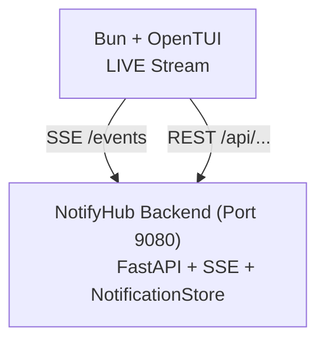

# NotifyHub TUI

> Terminal User Interface for NotifyHub — a real-time notification client in your terminal.

## Overview

The TUI is a full-screen terminal application that connects to the NotifyHub backend to display, browse, and manage notifications in real time. Built with [OpenTUI](https://opentui.dev) (React bindings) + Bun.

## Architecture



## Features

### 1. Live Notification Stream
The main view is a real-time scrolling feed of notifications received via SSE from the backend.
- Auto-scrolling feed (sticks to bottom)
- Receives an `init` snapshot on connect, then live `notification` events
- The `init` snapshot is capped by `NOTIFYHUB_TUI_PAGE_SIZE` (default 30); older pages load on
  scroll or with `l`
- Keyboard navigation: `j`/`k` or `↑`/`↓` to select individual cards
- Delete selected notification: `Delete` or `Backspace`
- Viewport culling for performance with large lists

### 2. Notification Cards
Each notification is rendered as a bordered card (rounded corners) with:

```
╭──────────────────────────────────────────────╮
│V VoiceAI_ASR                           @host │  ← colored avatar + bold title + host pill
│                                         time │  ← timestamp directly below host pill
│ /home/lamnt45/git/VoiceAI_ASR               │  ← full pwd path (dimmed)
│ @USER ok, but i also want to the…           │  ← message with tag highlighting
╰──────────────────────────────────────────────╯
```

- **Colored avatar initial** — derived from a hash of the pwd path (15-color palette matching the web UI)
- **App name** — last segment of the pwd path, bold white
- **Timestamp** — formatted as `HH:MM AM/PM`, sits on its own row beneath the host pill (or on the title row if no host_model)
- **Full pwd path** — dimmed gray
- **Host-model tag** — `@Mac153` pill at the top-right corner of the card, colored via FNV-1a hash of host_model string into 15-color palette, then **dimmed** to 40% strength against the card background (`mixHex(bright, cardBg, 0.4)`) so it's visually secondary to the avatar. Text uses `theme.text` for contrast in both light and dark modes.
- **Tag highlighting** — `[#tag:...]` rendered in gray, `[#truncated:...]` in dark gray
- **Selection** — highlighted border and background on the focused card

### 3. Live Agent Status Dock
Above the notification stream, a bordered dock shows **sessions in motion** — the "loading
animation while a chat is on" (fed by the [agent-status](agent-status.md) reporters):

```
┌────────────────────────────────────────────────────────────────┐
│⠙ ◇ opencode · NotifyHub · 2m ago                               │  ← spinner while running
│⚠ ✳ claude · hanoi-testing-platform · 40s · waiting for you    │  ← blocked on a permission
│◼ ◐ codex · VoiceAI_ASR · 31m · stalled?                       │  ← no refresh for 5+ min
└────────────────────────────────────────────────────────────────┘
```

- Entries arrive via the `agent_status` SSE event (e2e-decrypted like notifications) and resync
  from `GET /api/status` on reconnect
- **running** rows animate a braille spinner and carry the directory-color hash and elapsed
  `since` time (status only — the task excerpt is not shown; it remains in the API payload for
  other consumers)
- The dock keeps its full height; the stream below uses the remaining space (`flexGrow`), so
  live rows are never squeezed by a long notification list
- **idle** entries are hidden (their completion already rendered as a notification card); the
  row also disappears the moment its completion notification lands — matched by
  `data.session_id` stamped on every completion push
- **stale** is mirrored client-side (running + `updated` older than 5 min) so the marker appears
  even between SSE events
- An entry that cannot be decrypted (wrong/missing key) is dropped rather than locked — status
  is ephemeral, recomputed on every event

### 4. Status Popup
Press `s` to toggle a centered overlay showing:
- Connection status (`● Connected` / `○ Disconnected`) with host:port
- Total notification count
- SSE streaming status
- E2E status: server state + `kid`, whether a local key is set, and the locked-row count
- Dismisses on any key press

### 5. End-to-End Decryption
When the backend has [e2e encryption](e2e-encryption.md) enabled, payloads arrive
as AES-256-GCM envelopes and the TUI decrypts them locally (`utils/crypto.ts`,
WebCrypto). Cards that cannot be decrypted render as a `LOCKED` card showing the
envelope `kid`, so a wrong/missing key is obvious.

## Theme

High-contrast dark theme:

| Role | Color |
|------|-------|
| Page background | `#0a0a0a` |
| Card background | `#141414` |
| Card background (selected) | `#1e1e1e` |
| Card border | `#2a2a2a` |
| Card border (selected) | `#555555` |
| Title text | `#ffffff` bold |
| Body text | `#d4d4d4` |
| Dimmed text | `#888888` |
| Timestamp | `#999999` |
| Footer background | `#0d0d0d` |
| Popup background | `#111111` |

## Keyboard Shortcuts

| Key | Action |
|-----|--------|
| `j` / `k` or `↑` / `↓` | Navigate notification list |
| `Delete` / `Backspace` | Delete selected notification |
| `s` | Toggle status popup |
| `q` | Quit the TUI |
| `Ctrl+C` | Quit (handled by renderer) |

## Project Structure

```
src/notifyhub/tui/
├── package.json              # Bun deps: @opentui/core, @opentui/react, react 19
├── tsconfig.json             # TypeScript + JSX config
├── src/
│   ├── index.tsx             # Entry point — creates CliRenderer, mounts App
│   ├── App.tsx               # Main layout, keyboard nav, popup management
│   ├── types.ts              # NotificationItem, NotificationData, ServerInfo, E2EInfo, AgentStatusEntry types
│   ├── utils/
│   │   ├── api.ts            # REST API client + SSE connection (manual parser)
│   │   └── crypto.ts         # AES-256-GCM envelope decryption (WebCrypto)
│   ├── hooks/
│   │   └── useNotifications.ts  # SSE subscription + notification/agent-status state mgmt
│   └── components/
│       ├── NotificationStream.tsx   # Live auto-scrolling feed with nav
│       ├── NotificationRow.tsx      # Notification card renderer (+ LOCKED cards)
│       ├── AgentStatusDock.tsx      # Live running/blocked/stalled agent rows (spinner)
│       └── StatusPopup.tsx          # Centered status overlay
│
├── src/__tests__/            # bun test suites (utils, components, crypto)
```

## API Integration

### SSE Endpoint (`/events`)
The TUI connects to the SSE stream using the Fetch API + ReadableStream reader:
1. Sends `GET /events?limit=<page size>`
2. Parses SSE **blocks** manually: `event:`/`data:` fields, CRLF line endings, and payload lines
   that span multiple network chunks (the parser keeps the whole incomplete block, so an event
   name is never lost when a large payload is split)
3. Handles events: `init`, `notification`, `delete`, `clear`, `heartbeat`, `shutdown`,
   `agent_status` (live agent session states → the dock)

### REST Endpoints
- `GET /api/notifications` — Fetch all notifications (used on connect and periodic refresh)
- `DELETE /api/notifications?id=xxx` — Delete a single notification
- `GET /api/e2e` — Server e2e state `{enabled, alg, kid}` (shown in the status popup)
- `GET /api/status` — Live agent statuses (dock resync on SSE reconnect)

## Commands

```bash
# Install dependencies (after cloning)
make tui-deps
# Equivalent: cd src/notifyhub/tui && bun install

# Run the TUI (backend must be running on :9080)
make tui
# Equivalent: cd src/notifyhub/tui && bun src/index.tsx
# make tui first prints "e2e key: <source> (kid …)" when a key is configured
```

## Configuration

The TUI connects to `localhost:9080` by default and honors the same backend-address
env vars as the CLI (so a TLS funnel target works unchanged):

| Env var | Default | Description |
|---------|---------|-------------|
| `NOTIFYHUB_CLI_HOST` | `localhost` | Backend host |
| `NOTIFYHUB_CLI_PORT` | `9080` | Backend port |
| `NOTIFYHUB_CLI_SCHEME` | `http` | `http` or `https`; the scheme's default port (80/443) is omitted from the URL |

E2E decryption key (see [e2e-encryption.md](e2e-encryption.md)) — resolved in
order: `NOTIFYHUB_E2E_KEY` env → `e2e.key` in `config.jsonl`/`config.json` →
key file:

| Env var | Default | Description |
|---------|---------|-------------|
| `NOTIFYHUB_E2E_KEY` | _(unset)_ | AES-256-GCM key (base64/hex); overrides the config/key file |
| `NOTIFYHUB_CONFIG` | `~/.config/notifyhub/config.jsonl` | Config file to read `e2e.key` from (JSON5) |
| `NOTIFYHUB_E2E_KEY_FILE` | `~/.config/notifyhub/e2e.key` | Key file used when the other sources are unset |
