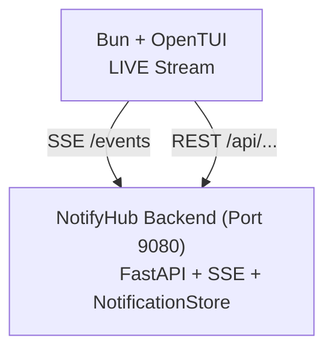

# NotifyHub TUI

> Terminal User Interface for NotifyHub — a real-time notification client in your terminal.

## Overview

The TUI is a full-screen terminal application that connects to the NotifyHub backend to display, browse, and manage notifications in real time. Built with [OpenTUI](https://opentui.dev) (React bindings) + Bun.

Module README: [`src/notifyhub/tui/README.md`](../../src/notifyhub/tui/README.md).

## Architecture



## Features

### 1. Live Notification Stream
The main view is a real-time scrolling feed of notifications received via SSE from the backend.
- Auto-scrolling feed (sticks to bottom)
- Receives an `init` snapshot on connect, then live `notification` events
- The `init` snapshot is capped by `NOTIFYHUB_TUI_PAGE_SIZE` (default 30); older pages load on
  scroll or with `l`
- **Select mode** (`v`): `j`/`k` or `↑`/`↓` to move the selection, `PgUp`/`PgDn` to move by five,
  `Home`/`End` for first/last, `Delete`/`Backspace` to delete, `Esc` to deselect. The selected card
  is kept on-screen with `scrollChildIntoView()` and the SELECT MODE banner is pinned above the
  scrollbox.
- With select mode off, `↑`/`↓`/`←`/`→` scroll the feed directly.
- Viewport culling for performance with large lists

### 2. Notification Cards
Each notification is rendered as a bordered card (rounded corners) with:

```
╭──────────────────────────────────────────────╮
│V VoiceAI_ASR                           @host │  ← colored avatar + bold title + host pill
│                                         time │  ← timestamp directly below host pill
│ /home/lamnt45/git/VoiceAI_ASR               │  ← full pwd path (dimmed)
│ @USER ok, but i also want to the…           │  ← message with tag highlighting
╰──────────────────────────────────────────────╯
```

- **Colored avatar initial** — derived from a hash of the pwd path (15-color palette matching the web UI)
- **App name** — last segment of the pwd path, bold white
- **Timestamp** — relative via `formatRelativeTime`: `now`, `5m ago`, `3h ago`, `Yesterday`,
  or `MM/DD/YY`; sits on its own row beneath the host pill (or on the title row if no host_model)
- **pwd path** — dimmed gray, truncated to 80 characters, omitted when missing
- **Host-model tag** — `@Mac153` pill at the top-right corner of the card, colored via FNV-1a hash of host_model string into 15-color palette, then **dimmed** to 40% strength against the card background (`mixHex(bright, cardBg, 0.4)`) so it's visually secondary to the avatar. Text uses `theme.text` for contrast in both light and dark modes. The CLI resolves `host_model` from `HOST_MODEL`, then an exported `HOSTNAME`, then `socket.gethostname()`, so the pill does not disappear on shells that keep `HOSTNAME` unexported.
- **Tag highlighting** — `[#tag:...]` rendered in gray, `[#truncated:...]` in dark gray
- **Truncation markers** — adjacent markers from the plugins (`+24 LINES`, `+517 CHARS`) collapse
  into one bracketed note: `[+24 lines, +517 chars] `. The note owns its surrounding whitespace, so
  it never glues to the message or double-spaces the following text.
- **Content-measured height** — cards have no fixed height. Yoga measures the wrapped message, the
  optional `pwd` row and the host-model row; `flexShrink={0}` keeps the scrollbox from squashing
  them. Trailing blank lines are removed, and single-line fields use `wrapMode="none"`.
- **Selection** — highlighted border and background on the focused card

### 3. Waiting Notification Cards
Above the notification stream, sessions in motion render as **notification cards in waiting** —
the same chrome as a completed notification, with the running prompt and a live assistant line
(fed by the [agent-status](agent-status.md) reporters):

```
╭────────────────────────────────────────────────────────────────╮
│  N  NotifyHub                             ◇ opencode  ⌂ Mac153 │  ← project avatar + agent/host pills
│                                                         2m ago │  ← session age (`since`)
│ /home/lamnt45/git/NotifyHub                                    │
│ @USER add a waiting card to the TUI                            │  ← running prompt excerpt
│ @ASSISTANT                                           loading ⠙ │  ← live spinner while running
╰────────────────────────────────────────────────────────────────╯
╭────────────────────────────────────────────────────────────────╮
│  H  hanoi-testing-platform                     ✳ claude  ⌂ wsk │
│                                                        40s ago │
│ /home/lamnt45/git/hanoi-testing-platform                       │
│ @USER why does the parser drop the last chunk?                 │
│ @ASSISTANT                                   waiting for you ⚠ │  ← blocked on a permission
╰────────────────────────────────────────────────────────────────╯
```

- Entries arrive via the `agent_status` SSE event (e2e-decrypted like notifications) and resync
  from `GET /api/status` on reconnect
- The header mirrors a real card: project avatar initial (pwd hash), bold project title, full pwd,
  relative session age (`since`), a pill naming the coding agent (`◇ opencode`, `✳ claude`,
  `◐ codex`), and the reporting machine's host pill (`⌂ Mac153`, `⌂ wsk`, …). The host pill uses
  the same dimmed tag treatment as `host_model` on completed cards and is omitted when the
  reporter sent no host
- `@USER` shows the ≤160-char task excerpt reported with the running state; if the reporter had
  no prompt it renders a dim `(no task excerpt)`. The task excerpt is already in the
  `agent_status` payload — the old dock simply chose not to render it.
- `@ASSISTANT` is the live line, with its state and spinner snapped to the card's bottom-right
  corner: a shimmering gerund + spinner while running (`loading`, `pondering`, `noodling`, …,
  chosen once per turn from the session + task excerpt), `waiting for you ⚠` when blocked on a
  permission, `stalled? ◼` when a `running` entry has not refreshed for 5 minutes
- Running cards use the accent border, permission/input waits use the warning (amber) border, and
  stalled cards use the danger (red) border. The `waiting for you ⚠` and `stalled? ◼` text follows
  the same distinction, so an action-needed prompt never looks like a dead session. The card
  background is a 10% mix of that border color into the theme background, giving each state a
  faint wash without competing with the text. Cards are
  content-measured (`flexShrink={0}`) and the stream below uses the remaining space
  (`flexGrow`), so live cards are never squeezed by a long notification list
- **idle** entries are hidden (their completion already rendered as a notification card); the
  card also disappears the moment its completion notification lands — matched by
  `data.session_id` stamped on every completion push
- **stale** is mirrored client-side (running + `updated` older than 5 min) so the marker appears
  even between SSE events
- The timestamp is `since` — **session age, not turn age**. The status API has no `turn_since`;
  a true per-turn clock would need a backend field.
- An entry that cannot be decrypted (wrong/missing key) is dropped rather than locked — status
  is ephemeral, recomputed on every event

### 4. Status Popup
Press `s` to toggle a centered overlay showing:
- Connection status (`● Connected` / `○ Disconnected`) with host:port
- Total notification count
- SSE streaming status
- E2E status: server state + `kid`, whether a local key is set, and the locked-row count
- Dismisses on any key press

The popup is sized to its content: 38 columns was too narrow for a funnel host
(`nuc.tail0ec64c.ts.net:443`), so the width is now
`min(terminal - 2, max(46, address.length + 22))`. The height is 17 rows
(7 content rows + 6 gaps + padding + border); a smaller fixed height makes Yoga overlap rows
instead of clipping them.

### 5. Help Popup
Press `h` or `?` to toggle a centered key-binding reference. It is 60 columns wide (or
`terminal - 2` on a narrower terminal) and 18 rows tall (14 content rows + padding + border). The
body lists select mode, navigation, delete/deselect, feed scrolling, status, help and quit.

### 6. End-to-End Decryption
When the backend has [e2e encryption](e2e-encryption.md) enabled, payloads arrive
as AES-256-GCM envelopes and the TUI decrypts them locally (`utils/crypto.ts`,
WebCrypto). Cards that cannot be decrypted render as a `LOCKED` card showing the
envelope `kid`, so a wrong/missing key is obvious.

## Theme

High-contrast dark theme (`DARK_THEME` in `src/theme.tsx`; a light variant follows the terminal
theme mode):

| Role | Color |
|------|-------|
| Page / renderer background | `#0a0a0a` |
| Card / popup background | `#000000` |
| Card background (selected) | `#2a2a2a` |
| Waiting-card background | 10% state border mixed into the theme background |
| Card border (normal) | `#808080` |
| Card border (selected) / accent | `#6fc3df` |
| Popup border | `#ffffff` |
| Title text (bold) / body text | `#ffffff` |
| Dimmed text | `#969696` |
| pwd path | `#a0a0a0` |
| Truncation marker | `#505050` |
| Footer background | `#2a2a2a` |
| Select-mode banner | `#1a3a5c` |
| Success / warning / danger | `#15ff15` / `#ffcc00` / `#ff5555` |

## Keyboard Shortcuts

| Key | Action |
|-----|--------|
| `v` | Toggle select mode |
| `j` / `k` or `↑` / `↓` | Move the selected card (select mode) |
| `PgUp` / `PgDn` | Move the selection by five cards (select mode) |
| `Home` / `End` | Jump to first/last card (select mode) |
| `Delete` / `Backspace` | Delete the selected card (select mode) |
| `Esc` | Deselect the card |
| `↑` / `↓` / `←` / `→` | Scroll the feed (select mode off) |
| `l` | Load the next older page |
| `s` | Toggle status popup |
| `h` / `?` | Toggle help popup |
| `q` | Quit the TUI (exits with code 0) |
| `Ctrl+C` | Quit (renderer `onDestroy`) |
| `Ctrl+Z` | Suspend; `SIGCONT` resumes |

Prototype-only: `1`–`7` jump scenarios, `n`/`p` cycle, `t` freezes time, `r` restarts the
harness (scenario 1, live clock, fresh popups/selection/scroll). See
[`docs/_meta/how-to-prototype.md`](../_meta/how-to-prototype.md).

## Project Structure

```
src/notifyhub/tui/
├── README.md                  # Module overview, commands, rendering invariants
├── package.json               # Bun deps: @opentui/core, @opentui/react, react 19
├── tsconfig.json              # TypeScript + JSX config
├── src/
│   ├── index.tsx              # Mounts App through renderTui()
│   ├── prototype.tsx          # Mounts PrototypeApp through renderTui() (mock data)
│   ├── render.tsx             # CliRenderer, ThemeProvider, onDestroy exit
│   ├── App.tsx                # AppView shell (layout/keys/popups) + App live wiring
│   ├── prototypes/            # Harness, scenarios and temporary seams
│   │   ├── PrototypeApp.tsx   # Scenario switcher, frozen clock, prototype bar, r restart
│   │   └── scenarios.ts       # Fake waiting cards (forever/stalled), variants, e2e, empty
│   ├── theme.tsx              # Dark/light palettes + ThemeProvider
│   ├── types.ts               # NotificationItem, NotificationData, ServerInfo, E2EInfo, AgentStatusEntry
│   ├── utils/
│   │   ├── api.ts             # REST API client + SSE connection (manual parser)
│   │   └── crypto.ts          # AES-256-GCM envelope decryption (WebCrypto)
│   ├── hooks/
│   │   ├── useNotifications.ts  # SSE subscription + notification/agent-status state mgmt
│   │   ├── useNow.ts            # Ticking clock for relative timestamps
│   │   └── useAudio.ts          # Notification sound
│   ├── components/
│   │   ├── README.md                  # Component-level invariants
│   │   ├── NotificationStream.tsx     # Live feed, select mode, scroll-to-selection
│   │   ├── NotificationRow.tsx        # Card renderer (+ LOCKED cards, marker formatting)
│   │   ├── WaitingCards.tsx           # Waiting notification cards (task + gerund + agent)
│   │   ├── StatusPopup.tsx            # Centered status overlay (content-sized)
│   │   ├── HelpPopup.tsx              # Centered key-binding reference (content-sized)
│   │   └── ErrorBoundary.tsx          # "Rendering error: …" fallback
│   └── __tests__/             # bun test suites (utils, components, crypto)
└── exp/                       # Scratch captures from debugging sessions
```

## Rendering and lifecycle rules

These are the invariants that broke in the 2026-11-11 session; check them before changing a
component. Full rationale: [`tui-rendering-rules.md`](tui-rendering-rules.md).

- **No hooks after an early return.** Branch by rendering a separate component; `NotificationRow`
  is a hook-free dispatcher.
- **Let Yoga measure cards.** No fixed card height; use `flexShrink={0}` inside the scrollbox and
  `wrapMode="none"` for single-line fields.
- **Popup height = content rows + gaps + padding + border.** Too small a height overlaps rows
  instead of clipping them. Width must fit the longest line (`host:port`).
- **Escape sequences belong in expressions.** `<text>{"NotifyHub \u2014 Help"}</text>`, not
  `<text>NotifyHub \u2014 Help</text>`.
- **State needs two channels.** Running is accent, permission waits are amber, stalls are red;
  the waiting-card border, status text/marker, and 10% background wash all use that mapping.
  Docked cards use `gap={0}`; normal feed cards use the softer `theme.cardBorder`.
- **Chrome rows are siblings of the scrollbox.** The SELECT MODE banner is `flexShrink={0}` above
  the scrollbox.
- **Scroll by id.** Give cards a stable renderable id and call `scrollChildIntoView()` after
  layout (`setTimeout(0)`).
- **Quit means exit.** `renderer.destroy()` alone leaves the SSE stream and timers alive; call
  `process.exit(0)`, with `onDestroy` as the Ctrl+C safety net.

## API Integration

### SSE Endpoint (`/events`)
The TUI connects to the SSE stream using the Fetch API + ReadableStream reader:
1. Sends `GET /events?limit=<page size>`
2. Parses SSE **blocks** manually: `event:`/`data:` fields, CRLF line endings, and payload lines
   that span multiple network chunks (the parser keeps the whole incomplete block, so an event
   name is never lost when a large payload is split)
3. Handles events: `init`, `notification`, `delete`, `clear`, `heartbeat`, `shutdown`,
   `agent_status` (live agent session states → waiting cards)

### REST Endpoints
- `GET /api/notifications?limit=&before=` — Latest page on connect; older pages for lazy loading
- `GET /api/notifications/count` — Notification count for the 15-second status poll
- `DELETE /api/notifications?id=xxx` — Delete a single notification
- `GET /api/e2e` — Server e2e state `{enabled, alg, kid}` (shown in the status popup)
- `GET /api/status` — Live agent statuses (waiting-card resync on SSE reconnect)

## Commands

```bash
# Install dependencies (after cloning)
make tui-deps
# Equivalent: cd src/notifyhub/tui && bun install

# Run the TUI (backend must be running on :9080)
make tui
# Equivalent: cd src/notifyhub/tui && bun src/index.tsx
# make tui first prints "e2e key: <source> (kid …)" when a key is configured

# Run the prototype harness with mock data (no backend, no e2e key)
make tui-prototype
# Runs under `bun --watch`: saving a source file restarts the harness.
# State (scenario, frozen clock) resets on restart; Bun --hot cannot preserve
# the React/OpenTUI root across module re-evaluation.
# Keys: 1-7 jump scenarios, n/p cycle, t freezes time, r restarts the harness,
# v/s/h work as in the app
# Rules: docs/_meta/how-to-prototype.md
```

## Configuration

The TUI connects to `localhost:9080` by default and honors the same backend-address
env vars as the CLI (so a TLS funnel target works unchanged):

| Env var | Default | Description |
|---------|---------|-------------|
| `NOTIFYHUB_CLI_HOST` | `localhost` | Backend host |
| `NOTIFYHUB_CLI_PORT` | `9080` | Backend port |
| `NOTIFYHUB_CLI_SCHEME` | `http` | `http` or `https`; the scheme's default port (80/443) is omitted from the URL |

E2E decryption key (see [e2e-encryption.md](e2e-encryption.md)) — resolved in
order: `NOTIFYHUB_E2E_KEY` env → `e2e.key` in `config.jsonl`/`config.json` →
key file:

| Env var | Default | Description |
|---------|---------|-------------|
| `NOTIFYHUB_E2E_KEY` | _(unset)_ | AES-256-GCM key (base64/hex); overrides the config/key file |
| `NOTIFYHUB_CONFIG` | `~/.config/notifyhub/config.jsonl` | Config file to read `e2e.key` from (JSON5) |
| `NOTIFYHUB_E2E_KEY_FILE` | `~/.config/notifyhub/e2e.key` | Key file used when the other sources are unset |

## History

- [2026-11-11 prototype polish](../plans/2026/11/11/2026-11-11-tui-prototype-polish.md)
  — parent: watch mode, `r` restart, `cardBorder`, docs.
- [2026-11-11 prototype polish — components](../plans/2026/11/11/2026-11-11-tui-prototype-polish-components.md)
  — bottom-right status, per-turn gerunds/shimmer, semantic colors, state tint, tight stack.
- [2026-11-11 prototype polish — harness](../plans/2026/11/11/2026-11-11-tui-prototype-polish-harness.md)
  — watch-mode loop, `r` remount, forever-loading/stalled fixtures.
- [2026-11-11 prototype polish — tests](../plans/2026/11/11/2026-11-11-tui-prototype-polish-tests.md)
  — alignment, word stability, shimmer, colors, tint, border, restart.
- [2026-11-11 prototype mode](../plans/2026/11/11/2026-11-11-tui-prototype-mode.md)
  — `make tui-prototype`, `AppView`, mock scenarios, `docs/_meta/how-to-prototype.md`.
- [2026-11-11 prototype harness](../plans/2026/11/11/2026-11-11-tui-prototype-mode-harness.md)
  — `PrototypeApp`, scenarios, frozen clock, compact bar.
- [2026-11-11 prototype tests](../plans/2026/11/11/2026-11-11-tui-prototype-mode-tests.md)
  — `Prototype.test.tsx`.
- [2026-11-11 waiting notification cards](../plans/2026/11/11/2026-11-11-tui-waiting-cards.md)
  — parent: dock replaced, App wiring, behavior, trials/lessons.
- [2026-11-11 waiting card component](../plans/2026/11/11/2026-11-11-tui-waiting-cards-component.md)
  — `WaitingCards.tsx` chrome, agent pill, `@USER`/`@ASSISTANT` lines.
- [2026-11-11 waiting card tests](../plans/2026/11/11/2026-11-11-tui-waiting-cards-tests.md)
  — `WaitingCards.test.tsx`, `layout.test.tsx`, 139 → 141 tests.
- [2026-11-11 machine ID on waiting cards](../plans/2026/11/11/2026-11-11-tui-waiting-card-machine-id.md)
  — host pill, `host_model` fallback, backend header precedence.
- [2026-11-11 machine-ID component](../plans/2026/11/11/2026-11-11-tui-waiting-card-machine-id-component.md)
  — `⌂` host pill.
- [2026-11-11 machine-ID tests](../plans/2026/11/11/2026-11-11-tui-waiting-card-machine-id-tests.md)
  — host/null-host assertions and integration coverage.
- [2026-11-11 render, popup and lifecycle fixes](../plans/2026/11/11/2026-11-11-tui-render-popup-lifecycle.md)
- [2026-11-10 agent status live broadcast](../plans/2026/11/10/2026-11-10-agent-status-live-broadcast.md)
